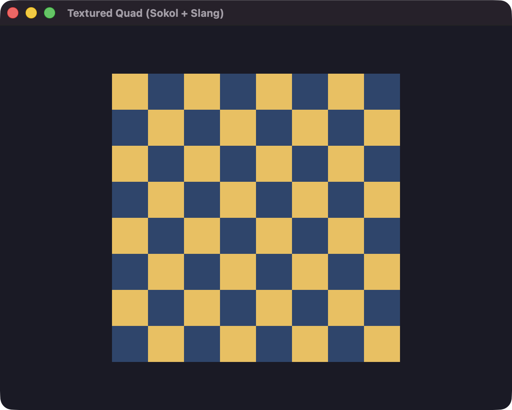

# sokol-slang

Compile Slang into a Sokol header with backend shaders, buffer structs, and
binding constants. Applications need only the header and Sokol.

[](examples/README.md#textured-quad)

Alpha: APIs may change. Windows/D3D11 and iOS execution are unverified.

## Build

Requires C++20, Python 3, Meson 1.1+, and Ninja. Tests also use `glslangValidator`.

```sh
meson setup build
meson compile -C build
meson test -C build --print-errorlogs
```

## Compile

```sh
python3 tools/sokol-slang examples/triangle/shader.slang \
  --module triangle -o build/triangle.h
```

A shader alone is enough: `sokol-slang shader.slang` writes `shader.h`.
Entry points, resource types, and bindings come from reflection.

Tools are discovered automatically; override with `--slangc` or `--core`.
Use `--targets` to select backends and `-I` for imports/includes.

[Examples](examples/README.md) · [Docker tests](docs/reference.md#docker) · [Reference](docs/reference.md)
