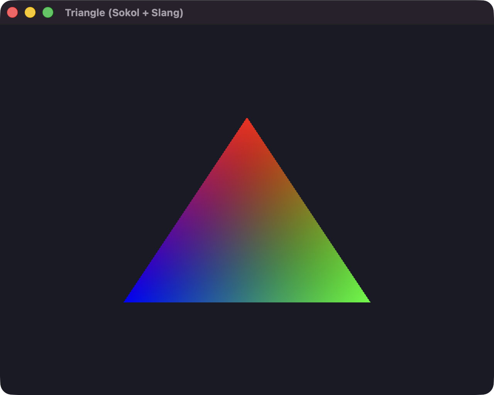
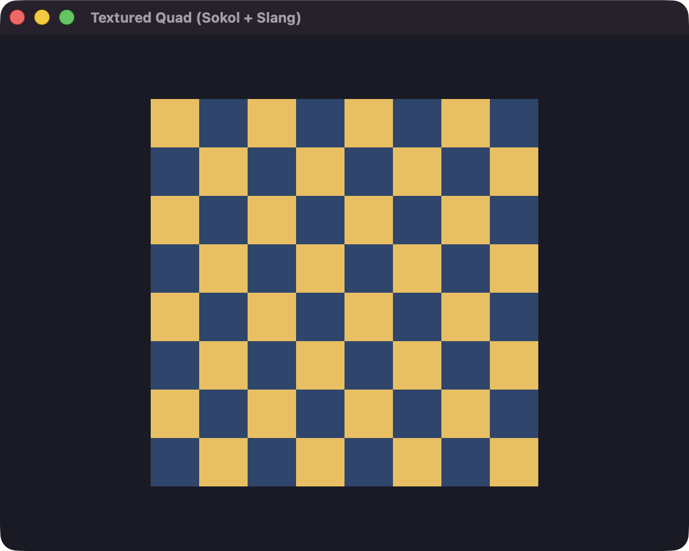
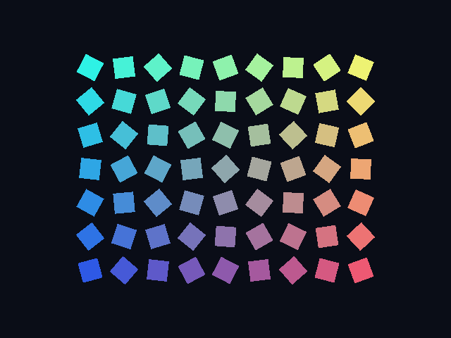
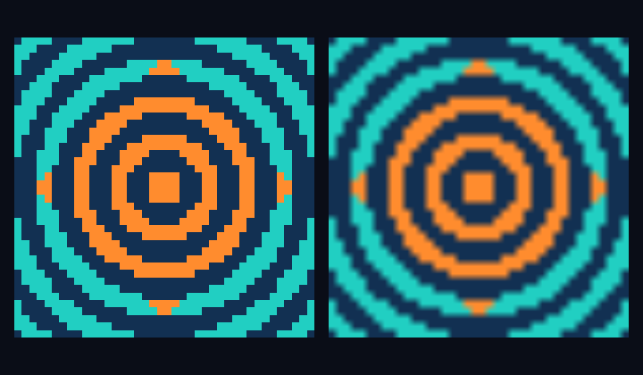
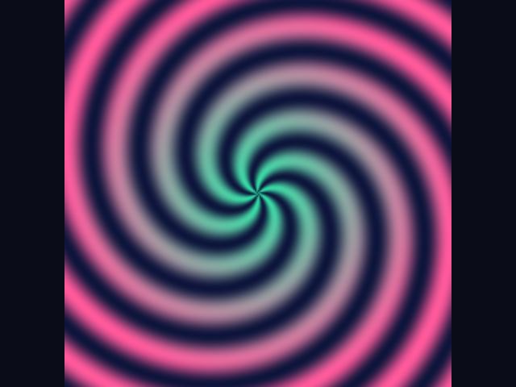

# Examples

- [triangle](triangle/): Draw a colored triangle with `sokol_app` and Slang.
- [textured-quad](textured-quad/): Draw an indexed checkerboard quad with a texture,
  sampler, and aspect-ratio uniform. No external assets required.
- [instancing](instancing/): Draw 63 rotating tiles in one instanced draw.
- [render-to-texture](render-to-texture/): Render a pattern into an image and
  compare nearest and linear filtering in a second pass.
- [compute-image](compute-image/): Dispatch a compute shader and display the
  image it writes.
- [meson-invocation](meson-invocation/meson.build): Compile shaders from Meson.

## Triangle



Build and run from the repository root:

```sh
meson setup build
meson compile -C build triangle-app
./build/examples/triangle/triangle-app
```

If `build` already exists, run `meson setup --reconfigure build` before compiling
to refresh the available targets.

## Textured quad



Build and run using the same build directory:

```sh
meson compile -C build textured-quad-app
./build/examples/textured-quad/textured-quad-app
```

## Instancing



One vertex buffer holds the quad. A second buffer advances once per instance
and supplies the center and color of each tile.

```sh
meson compile -C build instancing-app
./build/examples/instancing/instancing-app
```

## Render to texture



Two raster programs in one Slang file generate a 40 × 40 image and display it
twice. The preview on the left uses nearest filtering. The preview on the right
uses linear filtering.

```sh
meson compile -C build render-to-texture-app
./build/examples/render-to-texture/render-to-texture-app
```

## Compute image



Each frame dispatches groups of 8 × 8 threads to write an animated spiral into an
RGBA8 storage image. A graphics pass samples the same image through a texture
view. This example uses Metal on macOS, D3D11 on Windows, and OpenGL 4.3 on Linux.

```sh
meson compile -C build compute-image-app
./build/examples/compute-image/compute-image-app
```
