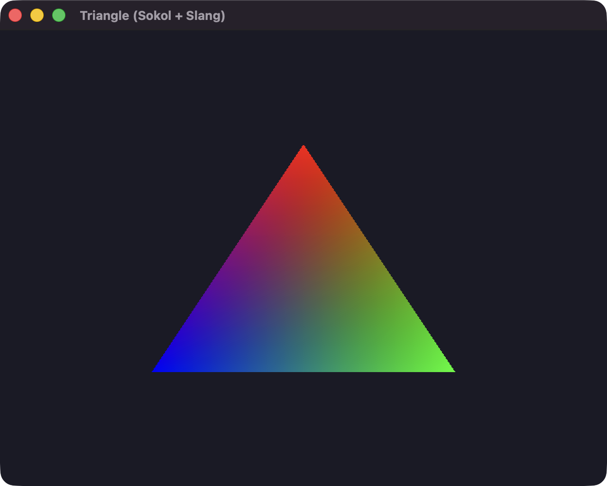
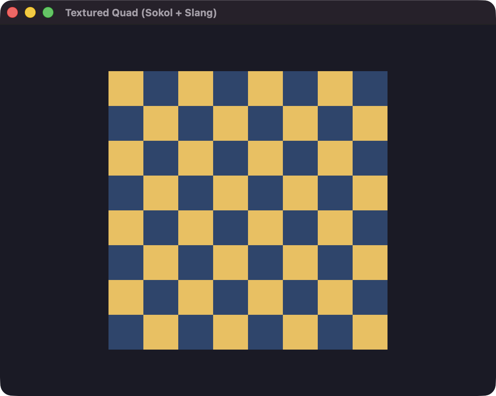

# Examples

- [triangle](triangle/): Draw a colored triangle with `sokol_app` and Slang.
- [textured-quad](textured-quad/): Draw an indexed checkerboard quad with a texture,
  sampler, and aspect-ratio uniform. No external assets required.
- [meson-invocation](meson-invocation/meson.build): Compile shaders from Meson.

## Triangle



Build and run from the repository root:

```sh
meson setup build
meson compile -C build triangle-app
./build/examples/triangle/triangle-app
```

If `build` already exists, run `meson setup --reconfigure build` before compiling
to refresh the available targets.

## Textured quad



Build and run using the same build directory:

```sh
meson compile -C build textured-quad-app
./build/examples/textured-quad/textured-quad-app
```
